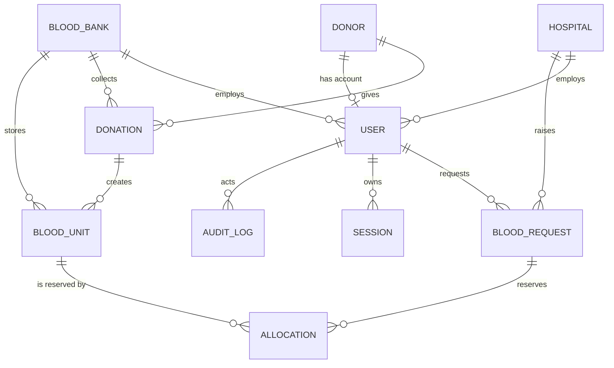

# BloodLink

[](https://github.com/ShaswataBarua/bloodlink/actions/workflows/ci.yml)
[](https://opensource.org/licenses/MIT)
[](https://www.typescriptlang.org/)
[](https://nextjs.org/)
[](https://www.postgresql.org/)
[](https://vitest.dev/)

**Blood bank inventory and emergency allocation for Bangladesh.**
Hack the Vibe 2026 (CODE-ARENAX) — Track: World Problem Solver.
Declared advanced challenges: **A05 Concurrency & Transaction Management** and **A03 Advanced Security & Access Control**.

Hospitals request blood, blood banks manage stock collected from donors, and the system allocates real units so the same unit can never be given to two patients. Everything runs against PostgreSQL; there is no mock data path.

**Live demo**: [https://bloodlink.vercel.app](https://bloodlink.vercel.app) *(deploy after Vercel + Neon setup)*

---

## 1. The problem

A hospital blood desk phones several banks during an emergency, and the same unit can be promised twice. Eligibility rules (age, weight, 90-day interval) are applied from memory. Nobody can answer "which units expire this week?" or "who changed this request?".

BloodLink makes the three workflows one system:

1. **Donors & donations** — eligibility is enforced by one rule set, and every completed donation creates a unit.
2. **Inventory** — searchable, filterable stock with FEFO (first-expiry-first-out) ordering and automatic expiry.
3. **Requests & allocation** — a single state machine, ABO/Rh compatibility, and transactional reservation that cannot double-allocate.

---

## 2. Stack

| Layer | Choice |
|---|---|
| App | Next.js 16 (App Router) + TypeScript (strict) |
| Styling | Tailwind CSS v4 |
| Database | PostgreSQL 16 (Neon in production) |
| ORM | **Drizzle ORM + node-postgres** |
| Validation | zod (strict schemas, shared by client and server) |
| Passwords | bcryptjs |
| Tests | Vitest (61 tests, real Postgres) |
| Deploy | Vercel |

> **Deviation from the original brief:** the brief said Prisma. Prisma's engine binaries could not be downloaded in the build environment, so the schema uses Drizzle, which is pure npm. The data model, constraints, partial unique index and audit trigger are identical in intent; the SQL lives in `drizzle/`. Everything else is unchanged.

---

## 3. Architecture

```
src/
  app/
    (app)/                 authenticated shell: dashboard, requests, inventory,
                           donors, audit, race-lab, security-lab, me
    api/                   route handlers (auth, requests, inventory, donations,
                           donors, audit, race, security, profile, jobs)
    login/, register/      public pages
  components/              UI primitives + client forms
  domain/                  pure rules: blood groups, compatibility, eligibility,
                           request state machine, zod schemas
  server/                  session, policy matrix, guard, audit hash chain,
                           rate limiter, HTTP helpers, transaction retry
  services/                business logic against the database
  db/                      Drizzle schema + pool
drizzle/                   SQL migrations (constraints, trigger, indexes)
scripts/                   migrate / seed / reset
tests/                     domain, policy, auth, allocation, concurrency, audit
```

**Rule of thumb:** UI components never contain business rules. Routes authenticate, call the policy module, validate with zod, and delegate to a service. Services own transactions and write audit rows.

### ER diagram



Key database guarantees:

- `allocations` has a **partial unique index** on `(unit_id) WHERE released_at IS NULL` — one active allocation per unit, enforced by Postgres.
- `blood_requests` is unique on `(hospital_id, idempotency_key)`.
- `donations` is unique per donor per UTC day.
- CHECK constraints: 1-20 units per request, 300-550 ml per donation, expiry after collection, positive hospital cap.
- `audit_logs` has a trigger that raises on `UPDATE`, `DELETE` and `TRUNCATE` (append-only).

---

## 4. Business rules (M04)

**Donor eligibility** (`src/domain/eligibility.ts`) — age 18-60, weight ≥ 50 kg, ≥ 90 days since the last donation, not already donated today. Every failed rule returns its own reason.

**Compatibility** (`src/domain/compatibility.ts`) — standard ABO/Rh red-cell table. Allocation order is exact group first, then compatible groups, and FEFO inside each group. Expired or non-`AVAILABLE` units are never candidates.

**Request state machine** (`src/domain/request-state.ts`) — the only allowed transitions:

```
PENDING → APPROVED | RESERVED | WAITLISTED | REJECTED | CANCELLED | EXPIRED
APPROVED → RESERVED | WAITLISTED | REJECTED | CANCELLED | EXPIRED
WAITLISTED → RESERVED | REJECTED | CANCELLED | EXPIRED
RESERVED → FULFILLED | CANCELLED | EXPIRED
terminal: FULFILLED, REJECTED, CANCELLED, EXPIRED
```

Illegal transitions return HTTP 409 with the allowed set in the message.

**Priority** — CRITICAL > URGENT > ROUTINE. When stock is insufficient a request becomes `WAITLISTED` (or partially reserved, with the reason recorded). New stock triggers `processWaitlist()`, which serves priority first, then oldest request.

**Rejections with explanations** — unknown group, 0 or >10 units (zod + DB CHECK), hospital daily cap exceeded, donor ineligible, expired reservation at fulfilment time.

---

## 5. A05 — Concurrency and transactions

The reservation core is `reserveCore()` in `src/services/requests.ts`, always inside one transaction:

1. `SELECT ... FROM blood_requests WHERE id = $1 FOR UPDATE` — serialises work on the same request.
2. Candidate selection:
   ```sql
   SELECT id FROM blood_units
   WHERE status = 'AVAILABLE' AND expires_at > now() AND blood_group IN (...)
   ORDER BY CASE blood_group WHEN ... END, expires_at ASC
   LIMIT n
   FOR UPDATE SKIP LOCKED
   ```
3. Update the units to `RESERVED`, insert one `allocations` row per unit, update the request, append the audit row, commit.
4. Serialization failures / deadlocks (`40001`, `40P01`, `55P03`) are retried with bounded exponential backoff (`src/server/retry.ts`).

Why each piece matters:

- **`FOR UPDATE SKIP LOCKED`** lets ten simultaneous requests take different rows instead of queueing. A loser skips the locked row, finds no candidate, and goes to the waitlist — a clean rejection, not an error.
- **The partial unique index** is the last line of defence: even if application logic were bypassed, a second active allocation for the same unit is rejected by Postgres.
- **Crash mid-transaction** rolls back the unit update, allocation and audit row together. Nothing is half-written.
- **Idempotency**: `Idempotency-Key` + payload hash in `idempotency_records`, guarded by an advisory lock. Same key + same payload returns the stored response; same key + different payload returns **422**.

**Race Lab** (`/race-lab`, ADMIN and BANK_STAFF): resets the AB− fixture to exactly one available unit, creates N one-unit requests, and fires N real concurrent reservations. It reports winners, clean waitlists, errors, double allocations (must be 0), elapsed time and before/after stock.

The same scenario is asserted in `tests/allocation.test.ts` (10 concurrent reservations, exactly 1 winner, 0 double allocations).

---

## 6. A03 — Security and access control

- **One policy matrix** (`src/server/policy.ts`): role × action × ownership. Routes and services call `can()` / `authorize()`; there are no scattered role checks.
- **Tenant isolation**: hospital users only see and cancel their own requests; bank staff only write their own bank's stock; donors only see their own record. Cross-tenant access returns **404** (existence is not leaked) and writes a `DENIED` audit row.
- **Mass-assignment protection**: strict zod schemas reject unknown fields. `PATCH /api/profile` accepts only `name`; role and ownership fields cannot be set by any user. Only an admin can change roles.
- **Sessions**: 256-bit random token, stored only as SHA-256 hash; httpOnly + `SameSite=Lax` + `Secure` in production; 8-hour expiry; deleted on logout.
- **Login protection**: per-IP and per-email rate limits, generic error message, five failures lock the account for 15 minutes.
- **CSRF**: mutating routes reject a cross-origin `Origin`.
- **Security headers** in `next.config.ts` (CSP, frame-deny, nosniff, referrer policy).
- **Audit log**: every ALLOWED and DENIED action, with before/after JSON, actor, IP, and a SHA-256 hash chain (`prev_hash` + row payload). Appends are serialised with an advisory lock. The admin page can **verify the chain**; the database trigger blocks rewriting history.

**Security Lab** (`/security-lab`, ADMIN): six one-click scenarios, each executing the real code path and reporting the HTTP status plus the audit row created — IDOR, privilege escalation, donor hitting an admin endpoint, forged session cookie, idempotency replay, and audit tampering.

---

## 7. Search, validation and UX (M05-M07)

- Server-side search, filtering, sorting and pagination on units, requests and donors (group, status, expiry window, date range, name/phone).
- Dashboard aggregates: stock by group, expiring within 7 days, open/waitlisted requests, fulfilment rate, average fulfilment time.
- zod validation on the server and HTML constraint validation on the client; field-level errors; friendly 4xx messages; no stack traces.
- Responsive layout (sidebar on desktop, horizontal nav on mobile), semantic tables with `scope`, labelled inputs, visible focus rings, `aria-live` regions for action feedback.

---

## 8. Local setup

Requirements: Node 20+, PostgreSQL 16.

```bash
cp .env.example .env         # fill in the values
npm install
npm run db:reset             # drop schema + migrate + seed
npm run dev                  # http://localhost:3000
```

`npm run db:reset` rebuilds the demo dataset and is safe to run before a demo.

### Environment variables

| Variable | Purpose |
|---|---|
| `DATABASE_URL` | Postgres connection string (Neon pooled URL in production) |
| `DIRECT_URL` | Direct connection used by migrations |
| `SESSION_SECRET` | Reserved for signed values; sessions themselves are random DB tokens |
| `NEXT_PUBLIC_APP_URL` | Public origin, used in docs/links |
| `DB_POOL_MAX` | Connection pool size (default 20; raise for the 50-request race) |

Never commit `.env`. `.env.example` contains placeholders only.

### Test accounts

Password for every seeded account: `Passw0rd!demo`

| Role | Email | Tenant |
|---|---|---|
| ADMIN | `admin@bloodlink.test` | — |
| BANK_STAFF | `staff.dhaka@bloodlink.test` | Dhaka Central Blood Bank |
| BANK_STAFF | `staff.ctg@bloodlink.test` | Chattogram Regional Blood Bank |
| HOSPITAL | `dmch@bloodlink.test` | Dhaka Medical College Hospital (cap 20/day) |
| HOSPITAL | `square@bloodlink.test` | Square Hospital (cap 12/day) |
| HOSPITAL | `cmch@bloodlink.test` | Chattogram Medical College Hospital (cap 15/day) |
| DONOR | `donor1@bloodlink.test` | Rahim Uddin |
| DONOR | `donor2@bloodlink.test` | Nusrat Jahan |

Seed contents: 2 banks, 3 hospitals, 20 donors (three deliberately ineligible), ~120 units across all groups with varied expiry (including expired and near-expiry), requests in every state, and exactly one available AB− unit for the race demo.

### Tests

```bash
npm test          # 61 tests against a real Postgres test database
npm run typecheck
npm run build
```

The test database is rebuilt from the real migrations in `tests/global-setup.ts` using `.env.test`.

---

## 9. Demo script (YouTube)

1. **Problem + login** — sign in as `dmch@bloodlink.test`. Show the dashboard: stock by group, expiring units, open requests.
2. **Donation + eligibility** — as `staff.dhaka@`, pick an ineligible donor: the exact reason appears. Pick an eligible donor, record the donation; the new unit appears in inventory.
3. **Request workflow** — as the hospital, create a request (double-click submit: only one request exists thanks to the idempotency key). As bank staff, approve → reserve: the exact units and expiry dates appear. Mark fulfilled; unit status becomes ISSUED.
4. **Business rules** — request a group with no stock → WAITLISTED with a reason. Record a compatible donation → the waitlist is served automatically.
5. **A05 Race Lab** — run 10 (then 50) concurrent reservations for the last AB− unit: 1 winner, 9 clean waitlists, 0 double allocations, before/after stock.
6. **A03 Security Lab** — run each attack: 404 IDOR, 400 mass assignment, 403 admin endpoint, 401 forged cookie, 422 replay, 409 audit tamper. Then open Audit → Verify hash chain.
7. **Edge case** — let a reserved unit expire, run the expiry job (dashboard load does it), and show the request returning to the waitlist.

---

## 10. Deployment (Vercel + Neon)

1. Create a Neon project and copy the **pooled** connection string into `DATABASE_URL`, and the **direct** one into `DIRECT_URL`.
2. Push this repository to GitHub.
3. Import the repo in Vercel; add `DATABASE_URL`, `DIRECT_URL`, `SESSION_SECRET`, `NEXT_PUBLIC_APP_URL`.
4. Run migrations and seed once against Neon:
   ```bash
   DATABASE_URL="..." DIRECT_URL="..." npm run db:migrate
   DATABASE_URL="..." DIRECT_URL="..." npm run db:seed
   ```
5. Deploy. The build command is `next build`; no extra configuration is required.

For a fresh production demo, `npm run db:reset` drops and reseeds — it refuses to run with `NODE_ENV=production` unless `ALLOW_RESET=yes` is set.

---

## 11. Known limits

- The login rate limiter is in-memory per Vercel instance; the durable per-account lockout in `users` is the hard limit.
- The Race Lab is a demonstration surface and is restricted to ADMIN/BANK_STAFF; it creates real requests and real allocations.
- Blood units are modelled as red-cell concentrates (35-day shelf life); platelets/plasma are out of scope.
- No email/SMS notifications — the product is an operations console, not a patient-facing service.

---

## 12. Project links

| Link | Description |
|------|-------------|
| [GitHub Repository](https://github.com/ShaswataBarua/bloodlink) | Source code, issues, PRs |
| [Live Demo](https://bloodlink.vercel.app) | Vercel deployment (after setup) |
| [Contributing Guide](CONTRIBUTING.md) | Branching, commits, PR process |
| [Changelog](CHANGELOG.md) | Version history |
| [License](LICENSE) | MIT License |
| [Code Owners](.github/CODEOWNERS) | Review assignments |

---

## 13. Hackathon submission checklist

- [x] Public GitHub repo with README
- [x] Live URL (deploy to Vercel)
- [x] YouTube demo script (Section 9)
- [x] Architecture documentation (Section 3)
- [x] ER diagram (Section 3)
- [x] Setup instructions (Section 8)
- [x] Test accounts table (Section 8)
- [x] How to run tests (Section 8)
- [x] Viva Q&A notes (problem, workflow, A05 demo, A03 demo, edge case)

---

*Built for Hack the Vibe 2026 (CODE-ARENAX) — World Problem Solver track.*
*Blood bank operations for Bangladesh. No AI, no fluff — just verified behavior.*
